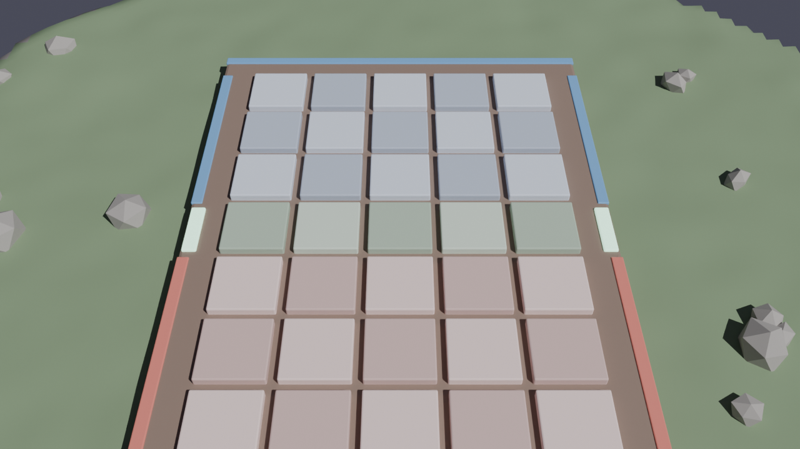
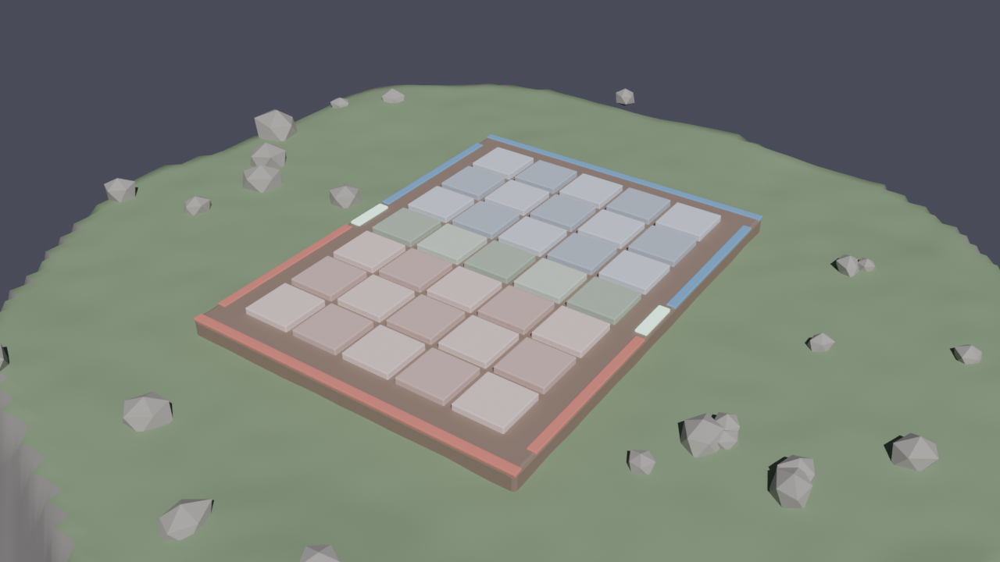
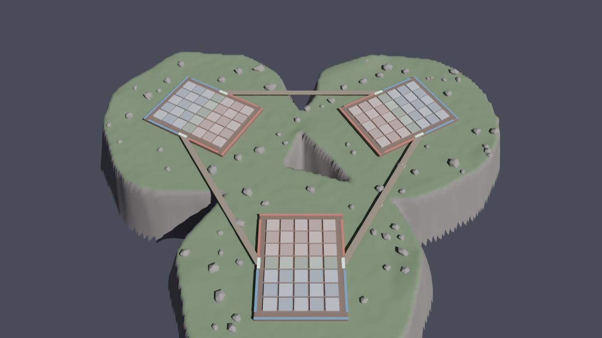
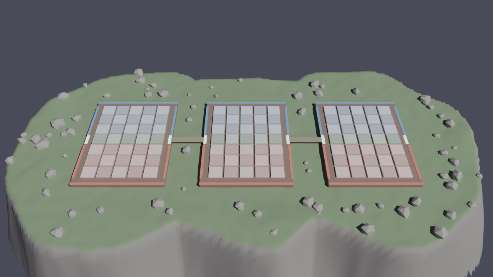

# Terrain Triad Chess — brief de design & pipeline Blender

> Statut : **blockout v0** (Phase 1). Géométrie générée par `tools/blender/build_terrain.py`.
> Les mécaniques restent définies par les specs ; le terrain est **purement cosmétique** et ne doit jamais contredire une règle.

---

## 1. Objectif (travail à rebours)

État final visé : un diorama « île flottante » à la Underlords, où chaque joueur lit **en moins d'une seconde** :
1. quelle moitié du plateau est à lui (Sud / Nord),
2. où est la ligne 4 (zone neutre = ligne d'invocation de l'Invocateur),
3. quels plateaux sont adjacents (3v3 : invocations inter-plateaux, Ultime Téléportation).

Tout ce qui ne sert pas l'une de ces lectures est du décor, et le décor doit rester **sous** le plan de jeu.

---

## 2. Règles de conception (vérifiées par le script)

| # | Règle | Pourquoi | Comment c'est garanti |
|---|---|---|---|
| R1 | Rien au-dessus de `z = 0` sur l'emprise du plateau, hormis les cases | Lisibilité + le picking souris du client intersecte le plan `y = 0` (`scene.lua:Scene:pick`) | Collines seulement à > 1,2 u du bord ; rochers à > 1 u ; vérifié : 0 violation sur les 3 layouts |
| R2 | Zones lisibles par la couleur seule | Décision rapide sous timer 20 s | Palette reprise de `models.lua` ; liserés bleu (Sud) / rouge (Nord) coupés à la ligne 4 |
| R3 | Noms stables + métadonnées glTF (`extras`) | Le client doit retrouver une case pour la surligner, un rail pour la fermeture anti-stagnation | `P1_tile_c4`, `P1_rail_west_south`, `P1_rune_east`, `bridge_P1_P2` + `tc_kind`, `col`, `row`, `zone`, `flank` |
| R4 | Déterministe (seed) | Cohérent avec le cœur pur ; diff reproductible | `CONFIG["seed"]`, `random.Random(seed)`, `noise.seed_set(seed)` |

### Contrat de coordonnées

| Espace | Case `(col, row)` |
|---|---|
| Menori (Y-up) — `scene.lua` | `((col-3)·1.1, 0, (row-4)·1.1)` |
| Blender (Z-up) | `((col-3)·1.1, -(row-4)·1.1, 0)` |

L'export glTF `+Y up` convertit `(x, y, z) → (x, z, -y)` : le `.glb` tombe pile sur la grille du client. Vérifié : `P1_tile_a1` exporté en `[-2.2, -0.07, -3.3]` (centre de la case, dessus à `y = 0`).

---

## 3. Sémantique des éléments

| Élément | Sens gameplay | Hook client |
|---|---|---|
| 35 cases biseautées | Grille 5×7, damier léger par zone | Recolorer par nom (sélection, cibles valides) |
| Liserés Sud / Nord | Propriété des lignes 1–3 / 5–7 | — |
| Runes lumineuses aux flancs de la ligne 4 | Ligne d'invocation de l'Invocateur | Pulse quand l'Invocateur est en ligne 4 |
| Rails ouest/est (colonnes a / e) | **Anti-stagnation 12 tours** : colonnes a/e fermées | `extras.flank_col` → lever/assombrir les rails à la fermeture |
| Cases `flank: true` | Idem, côté cases | Griser les colonnes fermées |
| Ponts `bridge_Px_Py` | Adjacence triangulaire P1↔P2↔P3 (aucune pièce ne les traverse) | VFX d'invocation inter-plateaux / Téléportation |
| Île, collines, rochers | Décor, cadrage caméra | — |

---

## 4. Layouts




`single` est la cible **Phase 1**. Les deux layouts 3 plateaux sont des **propositions** pour la question ouverte §8.3 (orientation visuelle de la connexion triangulaire). Aucun n'est verrouillé.

| Layout | Image | Pour | Contre |
|---|---|---|---|
| `triad_ring` |  | Triangle réel = règle P3↔P1 visible ; ponts accrochés aux runes ligne 4 → « l'Invocateur relie les plateaux » ; centre = « nexus » naturel pour l'Ultime | Asymétrie Sud extérieur / Nord intérieur (sans impact si chaque joueur a sa propre caméra) |
| `triad_line` |  | Fidèle au schéma des specs v3 ; spectateur lit tout d'un coup d'œil | Le lien P3↔P1 n'a pas de représentation évidente |

Ma recommandation : **`triad_ring`**, parce que c'est le seul où la géométrie *explique* la règle d'adjacence. À valider en Phase 2 seulement.

---

## 5. Workflow Blender MCP

Le MCP Blender tourne sur ta machine (pas dans le conteneur cloud). Workflow conseillé :

1. Ouvrir Blender, démarrer l'addon MCP, connecter Claude Desktop / Claude Code local.
2. Prompt : *« Exécute `tools/blender/build_terrain.py` avec `execute_blender_code`, layout `single`, seed 7 »* → blockout complet en une passe.
3. Itérer **par paramètres** (`CONFIG` : `seed`, `island_radius`, `prop_count`, `plateau_margin`) plutôt que par édition manuelle : le script efface et régénère la collection `TriadTerrain`.
4. Passe artistique **par-dessus** : les objets gameplay (`P1_tile_*`, rails, runes) restent générés ; tu habilles `Terrain` / `Props` à la main ou via le MCP (matériaux, Poly Haven, Hyper3D…).
5. Export : `CONFIG["export_path"] = "//client/assets/models/terrain_single.glb"` (ou chemin absolu), ou en headless :

```bash
blender --background --python tools/blender/build_terrain.py -- \
  --layout single --seed 7 --export client/assets/models/terrain_single.glb
```

Testé avec le module `bpy` 4.5 en headless : les 3 layouts se génèrent, s'exportent et se ré-importent.

### Et TrenchBroom MCP ?

Je le déconseille pour ce projet :
- TrenchBroom produit des `.map` à brushes (Quake/Half-Life) pensés pour des niveaux FPS en intérieur, pas pour un diorama vu de dessus.
- Menori charge du **glTF**, pas des `.map`/BSP → il faudrait un convertisseur en plus (`qodot`, `ericw-tools` + conversion), soit un maillon de plus sans gain.
- Blender couvre déjà le blockout (script) et l'habillage (MCP).

Il n'aurait d'intérêt que pour une vraie arène en intérieur (Phase 4, skins de map) ; même là, Blender reste plus direct.

---

## 6. Prochaines étapes

| # | Tâche | Où | Phase |
|---|---|---|---|
| 1 | Charger le `.glb` dans le client (`menori.glTFLoader` + `NodeTreeBuilder`), remplacer `_build_base`/`_build_board` ; garder le recolorage des cases par nom | `client/src/rendering/scene.lua` | 1 |
| 2 | Vérifier le sens de la caméra : dans le client, l'œil est côté `+z` Menori = **ligne 7 (Nord)**, donc le camp Nord est au premier plan (visible sur la vue caméra ci-dessus). Voulu ? | `camera.lua` | 1 |
| 3 | Passe artistique (matériaux, rochers sculptés, végétation basse) via Blender MCP | Blender | 1 |
| 4 | Brancher rails/runes sur l'état (anti-stagnation, Invocateur en ligne 4) | client | 1–2 |
| 5 | Trancher §8.3 (ring vs line) après playtest 3v3 | design | 2 |
